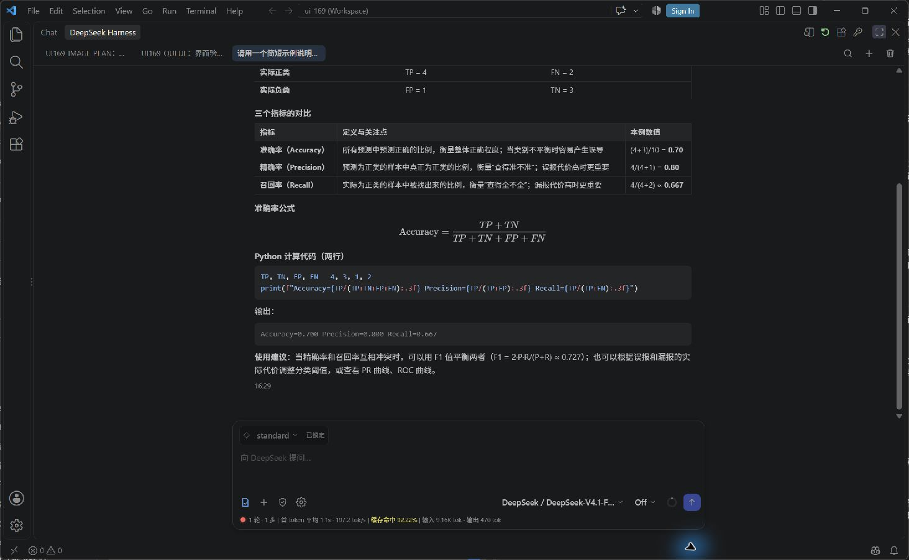
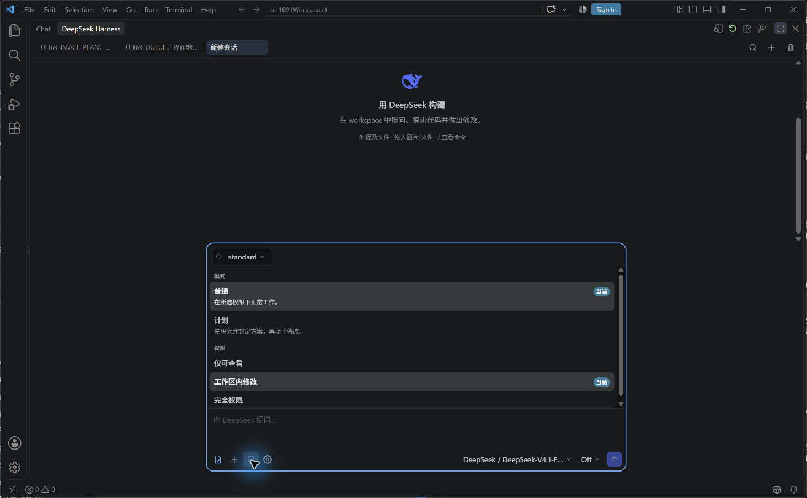

---
_file:
  created: "2026-10-29 15:08"
  updated: "2026-10-29 17:58"
  status: final
---

# DSH Sidebar

DSH Sidebar 把 DeepSeek Harness 的对话、工具调用、审批和任务状态放进 VS Code。你可以围绕当前项目提问、附加选区或文件、检查代码改动，并在编辑器里继续对话。

**0.1.171 · Windows 预览候选 · DeepSeek Harness 0.2.1-rc.4**

这是基于 [Lixxx1/dsh-vscode](https://github.com/Lixxx1/dsh-vscode) 整理的独立RC4适配版本，由Enxulansis维护。本项目保留原作者署名；不代表原项目或DeepSeek官方发布。

[预发布安装包](https://github.com/Enxulansis/dsh-sidebar/releases/tag/v0.1.171-rc4-preview.1) · [问题反馈](https://github.com/Enxulansis/dsh-sidebar/issues) · [来源与许可](docs/ORIGIN.md)

## 特色一览

在 VS Code 内阅读和处理项目任务：回答中的表格、公式与代码保留各自的排版；需要时使用对应复制入口，把结果继续用于编辑和写作。

| 功能 | 日常能解决什么问题 |
| --- | --- |
| 文件、图片与草稿 | 带着选区或截图提问，保留未发送内容 |
| 模式与三档权限 | 先规划再动手，按任务确认执行范围 |
| 消息队列与后台任务 | 运行中补充要求、编辑待处理消息，并检查任务状态 |
| 表格与公式复制 | 按目标用途选择 TSV／CSV、TeX／MathML 或 SVG／PNG |
| 搜索、轮次导航与标注 | 在长对话里找回结论和关键决定 |
| 阅读与通知设置 | 调整折叠、内容宽度、附件上限及提醒方式 |

普通／计划决定工作方式；仅可查看、工作区内修改、完全权限决定后端提供的执行权限。详见下文说明。

**[打开完整特色功能图解 →](docs/FEATURES.md)**，查看 12 张真实截图、文件格式徽标、公式／表格／代码复制反馈，以及提问停点和金色收藏的区别。图标来源见[许可说明](docs/ICON_ATTRIBUTION.md)。

## 文档导航

- [特色功能图解：真实截图与使用场景](docs/FEATURES.md)
- [安装、升级与回退](docs/INSTALL_WINDOWS.md)
- [故障排查与反馈](docs/TROUBLESHOOTING.md)
- [验证范围和已知限制](docs/PREVIEW_STATUS.md)
- [维护者发布检查](docs/RELEASE_CHECKLIST.md)
- [English overview](README.en.md)

## 发布和维护范围

本项目维护 **VS Code 侧栏及配套安装说明**。DeepSeek Harness 是独立后端，模型能力、工具目录和实际执行权限由后端及其配置提供。

**第三方运行时插件不在本项目的发布、适配或维护范围内。** 不打包旧环境中的第三方插件，不承诺迁移其配置、修复其兼容性或跟随其版本更新。侧栏保留的插件管理入口不改变这一范围；相关问题请联系对应插件维护者。

Router Standard／Router Spec 是此前配套环境验收所用的可选预设，不是安装侧栏就自带的模型或服务。基本使用可从后端提供的 standard 预设开始；使用自定义预设时，以其实际装配和维护来源为准。本项目不为其中的第三方依赖提供维护。

## 环境要求

| 项目 | 要求 |
| --- | --- |
| 系统 | Windows；其他平台未列入本候选验收范围 |
| VS Code | 1.100.0 或更高 |
| Node.js | 扩展声明为 `^22.19.0` 或 `>=24.0.0`；测试环境使用24.16.0 |
| 后端 | 精确版本 `@deepseek-ai/dsh@0.2.1-rc.4` |
| 模型 | 自行配置可用接口、凭据和额度 |
| 项目 | 打开你信任的工作区；受限模式不激活本扩展 |

旧0.1.5后端和后续alpha版本不属于本候选支持目标。为保持既有安装连续性，扩展ID仍为 `lixxx1.dsh-sidebar`；本候选通过GitHub分发，不代表原Marketplace发布者背书。VSIX不包含完整后端、模型凭据或个人数据。

## 第一次使用

1. 按 [安装指南](docs/INSTALL_WINDOWS.md) 准备独立RC4后端和数据目录，安装候选VSIX并重载窗口。
2. 打开右侧 **DeepSeek Harness**；找不到时运行 **DeepSeek Harness: 打开聊天**，也可选择 **在编辑器中打开聊天**。
3. 点击钥匙按钮打开 **模型与连接**，配置凭据并选择模型。凭据由当前后端管理，不要写入仓库设置或Issue。
4. 新建会话，选择预设、权限、普通／计划模式及推理强度。先发送只读任务确认连接正常。

示例：

> 阅读项目 README 和入口文件，概括启动方式及主要模块，先不要修改文件。

检查修改时先看文件差异，再决定保留或回退。文件回退不等于Git提交，也不能撤销已经执行的外部操作。

## 模式与权限

盾牌菜单承载两组设置。“普通／计划”是工作模式，配套RC4 base profile另提供三档权限。

| 设置 | 用途 |
| --- | --- |
| 普通 | 在当前权限下处理任务 |
| 计划 | 先研究和制定方案；不会因此自动获得更多权限 |
| 仅可查看 | 以只读操作为主；额外权限由后端决定拦截或请求审批 |
| 工作区内修改 | 按后端预设处理工作区修改，不等于任意系统路径可写 |
| 完全权限 | 使用后端配置的更宽权限；切换时保留确认流程 |

选项来自后端权限目录，选中项来自当前会话；自定义profile可能改变目录。审批卡表示某项操作需要决定，请先读操作和原因。权限选择不是操作系统级安全隔离保证。

连接中断时的审批决定不会自动重放。恢复连接后需重新确认；切换会话或重连后仍待处理的审批会恢复，已处理的请求不应重新成为待办。

## 队列和后台任务

任务运行期间发送的新消息可以进入队列。对未消费的消息，可使用界面入口编辑、保存，或引导当前任务。引导用于更新工作方向，不保证立刻打断已运行的工具。

停止当前生成后，继续检查是否还有待处理消息和运行中的后台任务；停止按钮不代表清空全部任务。后台任务列表显示后端报告的运行状态、完成状态和退出码。

审批、追问和任务结束可触发通知。设置台支持全部通知、仅需要操作和关闭。

## 文件、图片和草稿

- 编辑器右键 **把选区加到聊天**，或通过 `@` 添加文件／文件夹。发送前核对输入区上下文。
- 图片可粘贴、拖入、预览和缩放；支持的动图可选帧，所选帧作为静态图片发送。
- 附件数量、大小、压缩策略可在设置台调整。能附图不代表所选模型支持视觉输入。
- 默认保留未发送的文字、图片和文件草稿，成功发送后清除；关闭保留或清理存储会影响恢复。
- 已验证的图片准备阶段可停止并恢复草稿，需要配套 [运行时取消修补](docs/INSTALL_WINDOWS.md#图片准备取消修补)。修补不保证立即中止原生解码，也不会撤销已执行工具的副作用。

## 会话导航、搜索与复制

会话标签用于切换对话；搜索可定位正文、图片名称和文件路径。当前工作区搜索由侧栏实现，其他工作区结果依赖后端索引，不保证自定义profile默认可用。

轮次导航条支持跳转、收藏和标注。消息、代码块、表格及公式提供对应复制入口；公式支持的导出格式包括TeX、MathML、SVG和PNG，表格支持TSV或CSV。目标应用的格式支持会影响粘贴效果。

会话工具包括在Diff编辑器审阅改动、会话分叉及按现有入口回退。先检查操作提示中的影响范围；分叉会话不等于恢复磁盘文件。

## 模型、预设与设置

“模型与连接”管理当前后端支持的接口、凭据和模型标识。自定义提供方所需组件须自行具备，不作为第三方插件随侧栏分发。图片输入、推理强度和费用展示以实际模型能力及后端信息为准；token统计不等于账单。

预设决定会话装配的工具与工作方式，可选项来自后端。应在首轮发送前选择；已开始的会话按后端规则锁定预设。171包含重启后恢复持久化预设标签的修复。

| 常用设置 | 默认值及说明 |
| --- | --- |
| `deepseekHarness.home` | 空；使用 `DSH_HOME` 或默认目录。独立环境应显式配置，修改后重载 |
| `deepseekHarness.executable` | 空；自动寻找后端。候选应显式指向RC4启动器 |
| `deepseekHarness.arguments` | `web --host 127.0.0.1 --port 0`；使用本机随机端口 |
| `deepseekHarness.autoStart` | `true`；首次打开侧栏启动后端 |
| `deepseekHarness.reuseExistingRuntime` | `true`；符合条件时复用本机3080端口后端。自定义home会阻止复用无关实例 |
| `deepseekHarness.ui.keepDrafts` | `true`；保留未发送草稿 |
| `deepseekHarness.ui.notifyLevel` | `all`；也可选 `action` 或 `off` |
| `deepseekHarness.ui.diagnostics` | `false`；排障时开启，查看输出面板 |

更多设置包括附件上限、图片压缩、折叠、搜索高亮、轮次导航和通知样式。在设置台或VS Code设置中搜索 `deepseekHarness`，以安装版本实际选项为准。

## 可选自主调试

`deepseekHarness.autonomousDebugging` 默认关闭。启用后需要有效的 `.vscode/launch.json` 和对应语言调试扩展，并由侧栏启动受管理后端。它可向模型提供启动调试、断点、单步和变量检查能力，未列入本次RC4原生界面的完整验收项。

## 升级与验证范围

升级前保留旧VSIX、旧后端、数据目录和DSH设置。切换home不会自动迁移旧会话；本候选不承诺完整旧会话数据库迁移。参见 [回退步骤](docs/INSTALL_WINDOWS.md#回退)。

候选完成1111项单测、类型检查和构建；实际界面证据按场景分别对应169、170、171。详见 [验证范围](docs/PREVIEW_STATUS.md)，不将历史结果当作171所有场景重新运行。

## 反馈与许可

反馈请提供扩展／后端版本、系统环境、复现步骤、预期与实际结果及脱敏日志。不要提交密钥、个人会话库或完整home目录。问题请提交到 [Issues](https://github.com/Enxulansis/dsh-sidebar/issues)。

侧栏采用 [MIT License](docs/LICENSE.md)，保留原作者署名。DeepSeek Harness及其他依赖遵循各自许可，侧栏许可不替代其许可。随包依赖声明见 [THIRD-PARTY-NOTICES.txt](THIRD-PARTY-NOTICES.txt)，字体许可见 [OFL 1.1](licenses/OFL-1.1.txt)。
