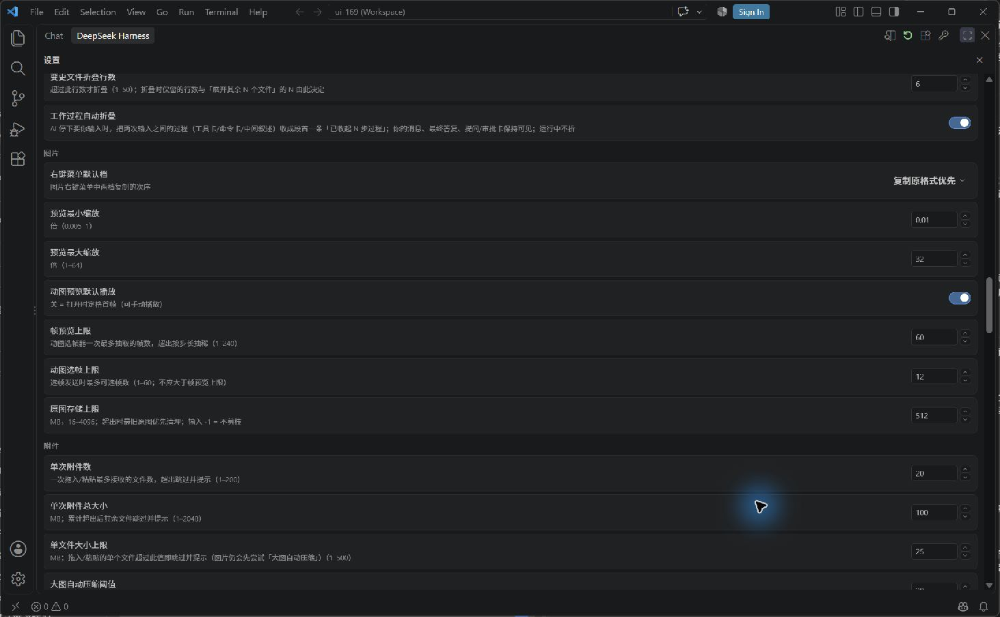
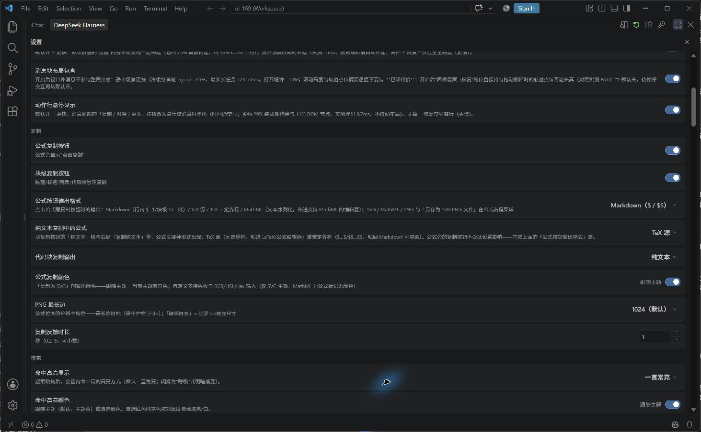
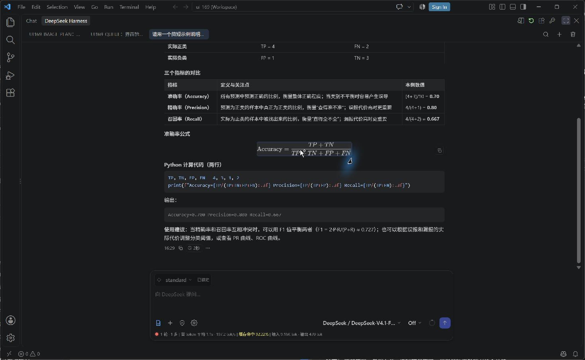
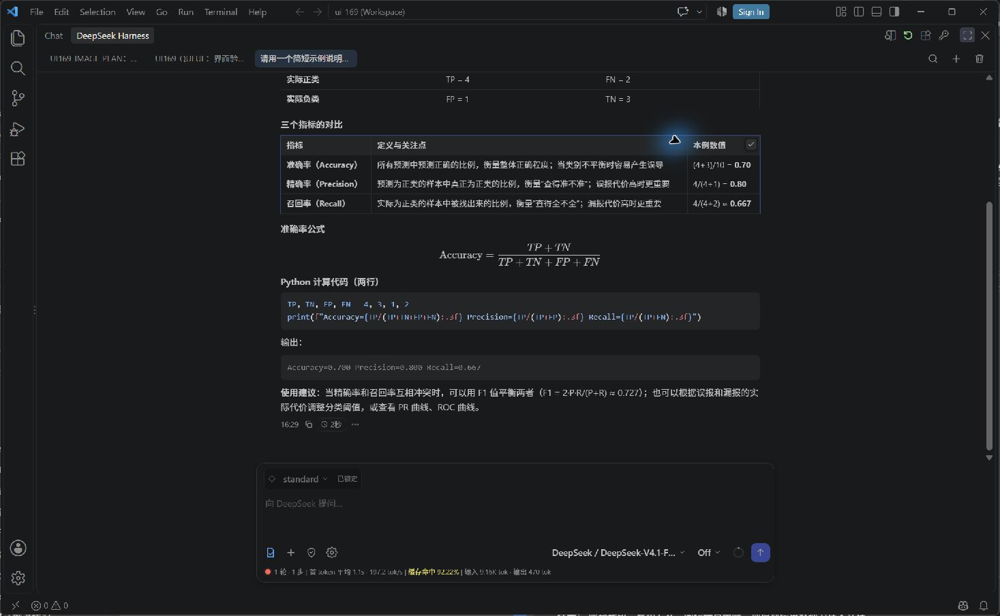
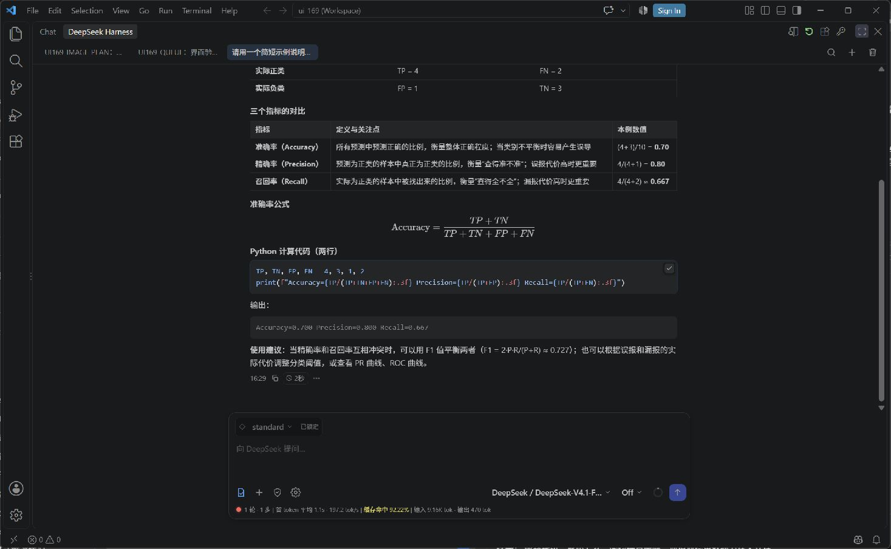
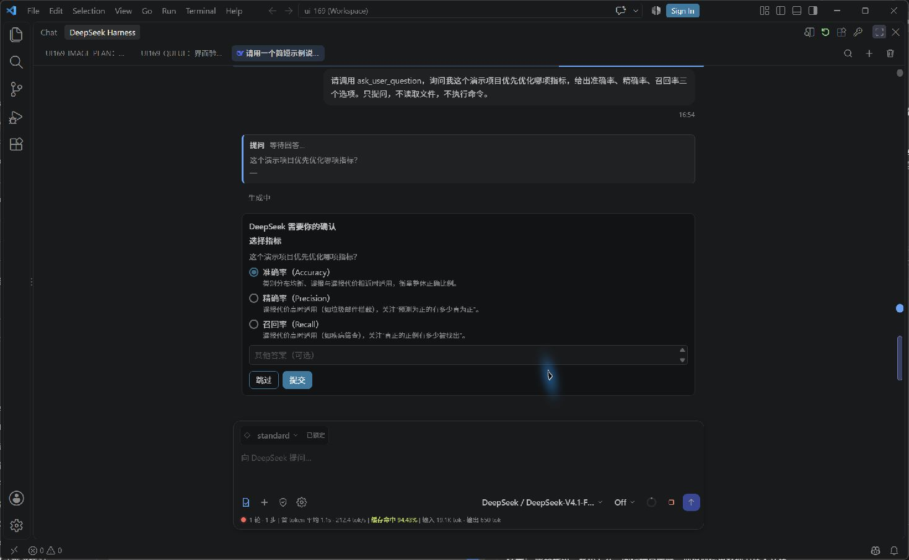
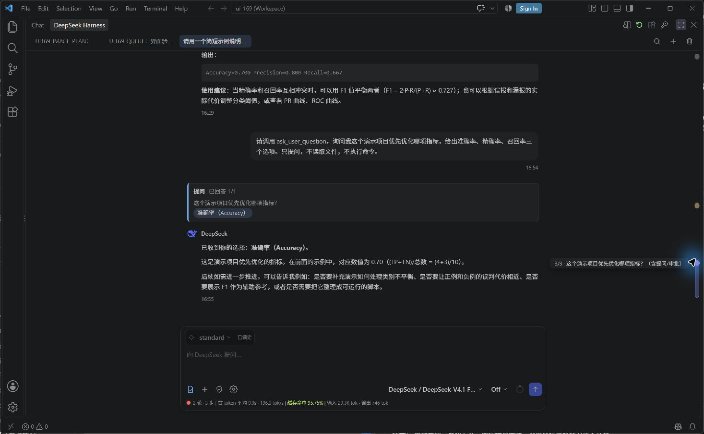
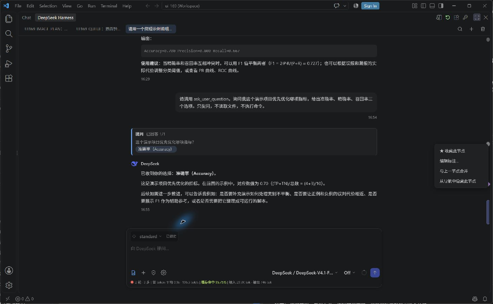
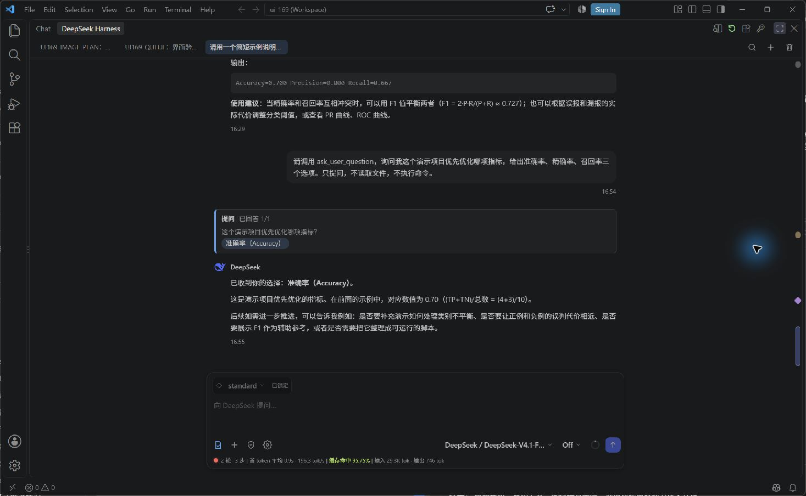
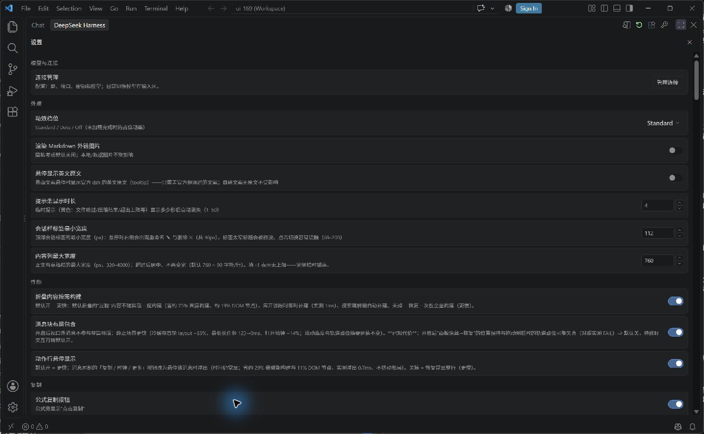

# 特色功能图解

[返回 README](../README.md) · [安装指南](INSTALL_WINDOWS.md) · [验证范围](PREVIEW_STATUS.md)

DSH Sidebar 的重点是把对话、执行过程和日常整理放在 VS Code 内：围绕项目工作，随时补充要求，在需要决定时处理审批，再把有用的结果复制到代码或文档中。

本页截图来自 Windows 上的 0.1.171 隔离测试窗口，后端为 DeepSeek Harness 0.2.1-rc.4。使用真实界面与专门准备的演示问题，没有合成界面或替换模型回答。窗口名中的 ui-169 是沿用的测试工作区名称，不是当前扩展版本。截图仅展示指定画面，不代表所有功能都在本轮重新验收；完整边界见验证范围。

## 1. 在一条回答里阅读表格、公式和代码

**适合：** 解释代码、比较方案、阅读计算步骤、把模型输出整理为技术文档。

表格按列阅读，公式以数学排版显示，代码块保留语法高亮。输入区同时提供预设、模型、推理强度及上下文入口；底部用量区帮助了解当前对话的输入输出和缓存情况。示例回答只演示排版，不是本项目提供的统计分析结论。

日常可以在侧栏聊天；需要阅读宽表格或较长代码时，可用顶部的“在编辑器中打开聊天”入口。长消息与工具过程支持折叠，需要细节时再展开。

## 2. 图片、文件与未发送草稿

### 按格式识别文件

附件上的格式徽标帮助快速区分代码、配置、文档和数据文件。下面直接展示插件内嵌的原始 SVG 资源，不是附件界面的截图；图片附件也可能显示内容缩略图。

| 代码与配置 | 文档与数据 | 其他文件 |
| --- | --- | --- |
|  Python |  Markdown |  ZIP |
|  TypeScript |  CSV / Excel |  图片 |
|  JSON |  PDF |  PowerPoint |
| |  Word | |

图标来自 Material Icon Theme 5.38.1，MIT 许可，Copyright (c) 2025 Material Extensions。[完整来源与许可说明](ICON_ATTRIBUTION.md)。图标用于识别格式，不表示模型能直接解析所有这些文件。

### 附件与草稿控制

**适合：** 结合错误截图、界面设计或项目文件提问。

编辑器右键“把选区加到聊天”，或在输入区使用 `@` 添加文件／文件夹。图片支持粘贴、拖入、预览和缩放；支持的动图可以选帧，发送的是选中的静态帧。发送前检查附件和选区，避免带入无关内容。

设置台可调整图片预览范围、选帧数量和附件数量／大小上限。能添加图片不代表当前模型支持视觉输入；先选择具备相应能力的模型。

未发送的文字、图片和文件草稿默认保留，成功发送后清除。图片准备阶段的取消与草稿恢复依赖[配套运行时修补](INSTALL_WINDOWS.md#图片准备取消修补)；原生解码可能完成后才丢弃结果，取消不会撤销已执行工具的副作用。

## 3. 工作模式与执行权限分开选择

**适合：** 先了解项目再修改，或者把一次任务限定在预期范围内。

点击输入区的盾牌，先决定工作方式，再确认权限：

| 选择 | 典型使用场景 |
| --- | --- |
| 普通 | 在当前权限下继续处理任务 |
| 计划 | 先分析需求、研究代码、给出方案 |
| 仅可查看 | 阅读项目并解释现状，暂不修改 |
| 工作区内修改 | 在项目范围内进行实现与修复 |
| 完全权限 | 确有需要时使用更宽的后端权限，切换时确认提示 |

例如先要求“阅读入口文件，列出修改方案”，确认方案后再继续实现。计划模式不是权限等级，也不会自动授予写入能力。权限目录来自当前后端 profile，实际拦截与审批由后端执行，不是操作系统级隔离。

审批卡出现时，先阅读操作及原因，再选择允许或拒绝。断线期间作出的决定不会自动重放，恢复连接后需要重新确认。

## 4. 任务运行时仍可补充要求

**适合：** 模型正在处理较长任务，你又想到约束条件或下一步工作。

运行期间发送的消息可以进入队列。对尚未消费的消息，可以通过队列入口编辑并保存；需要调整当前工作方向时，可以使用引导入口。

例如第一条要求“解释模块结构”，随后补充“重点看错误处理，不要修改代码”。先核对队列中的文字，避免把只适合下一轮的问题误当作当前任务的补充要求。引导并不保证立刻打断已经运行的工具。

后台任务有独立状态列表，可以检查运行中、完成状态和退出码。**停止当前生成不等于清空消息队列，也不等于结束所有后台任务。** 停止后仍应检查这两处。通知可选择全部、仅需要操作或关闭。

这一节说明已有任务管理能力，没有把历史验收截图当作本次新截图。运行、完成和退出码等验收记录见[验证范围](PREVIEW_STATUS.md)。

## 5. 按目标用途复制，而不是重新整理一遍

**适合：** 把回答中的代码、表格或公式转入编辑器、电子表格或写作工具。

| 内容 | 可选方式与用途 |
| --- | --- |
| 代码块 | 复制代码，继续在编辑器中修改 |
| 表格 | TSV／CSV，便于导入电子表格或后续处理 |
| 数学公式 | TeX／MathML，用于支持相应格式的编辑器 |
| 公式图像 | SVG／PNG，用于插图或展示 |

设置台可指定公式按钮默认输出、纯文本复制时公式的表示方式，以及公式 PNG 尺寸。目标应用支持的剪贴板格式不同；首次使用某种格式时先做一次小范围粘贴确认。此处展示设置能力，不宣称所有目标应用都已验收。

### 点击公式复制

直接点击公式即可复制，公式区域短暂高亮。演示环境选择 Markdown 输出，实际剪贴板内容为 `$$\text{Accuracy} = \frac{TP + TN}{TP + TN + FP + FN}$$`。若需要 TeX、MathML 或图片格式，请使用相应设置或右键导出入口。

### 复制表格

将指针移入表格，点击右上角复制按钮。图中显示复制后的勾号和表格高亮；本次核验剪贴板得到 Markdown 表格。TSV／CSV 使用对应的右键菜单入口，不要将默认按钮的 Markdown 输出误认为 CSV。

### 复制代码块

将指针移入代码块，点击右上角按钮。默认复制纯代码，不包含 Markdown 围栏；可在设置台切换输出方式。勾号是界面反馈，不等于已验证粘贴到所有外部应用。本轮直接核对了公式和表格的剪贴板文本；代码截图记录按钮反馈。

## 6. 长对话也能定位和整理

**适合：** 同一项目里反复比较方案，或需要找回之前的结论。

会话标签用于切换任务；搜索支持正文、图片名称和文件路径。搜索工具内容可以在设置台开启，适合查找命令或工具输出，但也可能增加结果噪声。当前工作区搜索由侧栏实现，跨工作区结果依赖后端索引。

轮次导航条支持跳转、收藏和标注：把关键决定收藏，把某一轮标为“接口约定”或“待复查”，以后沿导航条回到对应上下文。会话分叉可用于继续另一条讨论路线，但不会自动恢复磁盘文件。审阅代码修改时使用 Diff 入口，回退前核对影响范围。

### 提问卡片与停点

模型需要你作出选择时，`ask_user_question` 会生成提问卡片。选择选项后提交，回答会在对话中留下记录。普通节点与停点在右侧导航条中使用不同形状；本例提问留下的停点显示为紫色菱形。其他需要用户决定的事件也可能形成停点，不能把所有菱形都理解为同一种提问。

点击节点可定位对应位置，悬停提示帮助识别要跳到哪一轮。图中提示为第 3/3 个节点及对应问题。当前激活节点和普通节点也有颜色／大小区别，具体颜色随主题变化。

### 收藏变金色，标注单独管理

右键节点选择“★ 收藏此节点”，即可把重要位置保留下来。

本例中普通节点收藏后变为金色，下面未收藏的提问停点仍为紫色菱形。**形状表示节点类别，金色表示收藏**；收藏不会把普通节点改成提问停点。编辑标注只添加文字，不会自动收藏。合并或隐藏仅影响导航显示，可从节点菜单恢复。

## 7. 调整阅读体验，保留常用工作方式

设置集中提供内容宽度、会话标签宽度、消息折叠、搜索高亮、附件控制和通知等选项。先从默认值开始，遇到具体阅读问题再调整；例如长表格阅读困难时扩展内容区域，工具过程较多时使用折叠。

会话预设由后端提供，应在首轮发送前选择；已开始的会话按后端规则锁定预设。可以从 standard 开始。第三方预设及其运行时插件不随本项目分发，也不在适配维护范围内。

## 截图说明

本页 12 张界面截图均为 2026-10-29 在隔离环境保存的原始画面，另有 10 个从插件资源原样提取的文件格式 SVG。仅保留公开演示内容和设置画面，未包含密钥、个人对话内容或本机存储路径。界面语言、主题、模型名称和后端 profile 会影响实际外观；图中模型名称不构成可用性或额度承诺。
